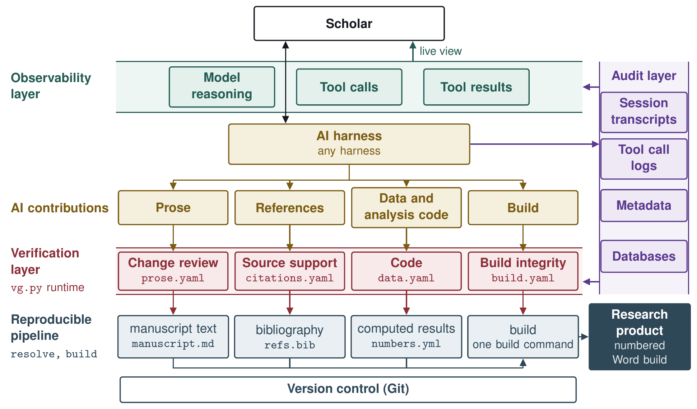
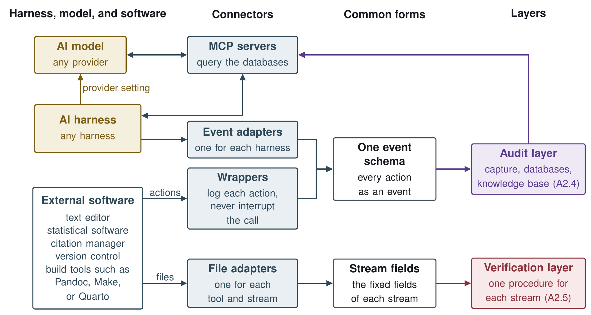
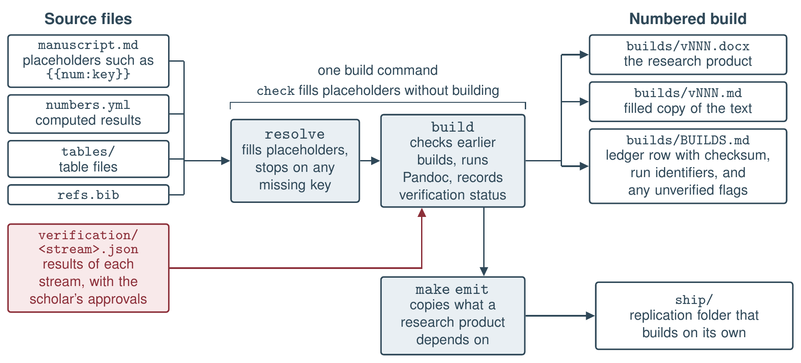
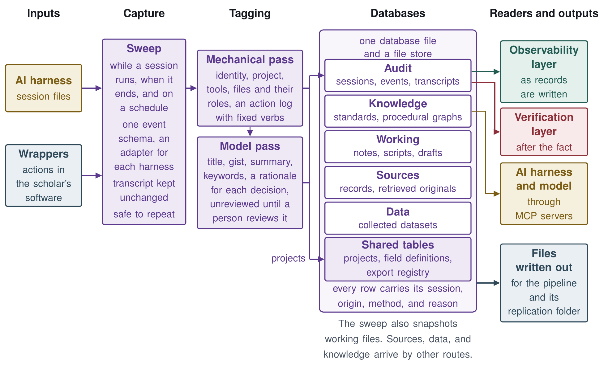
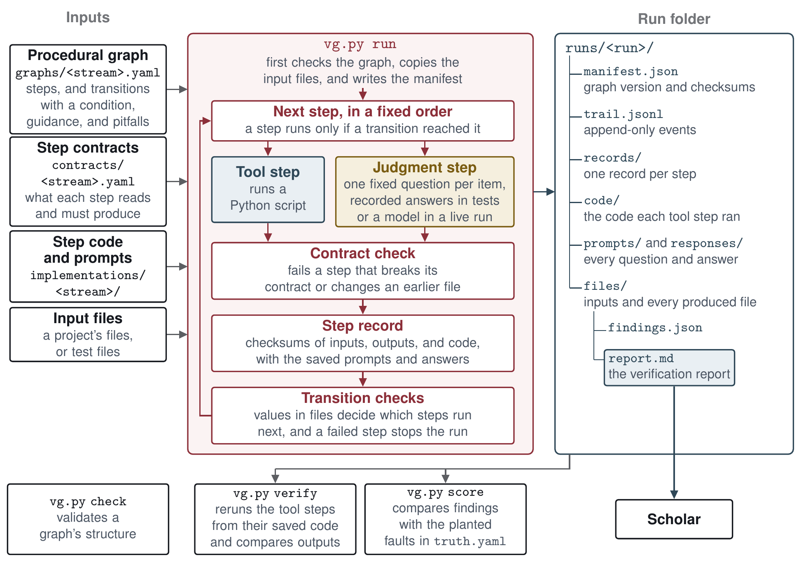
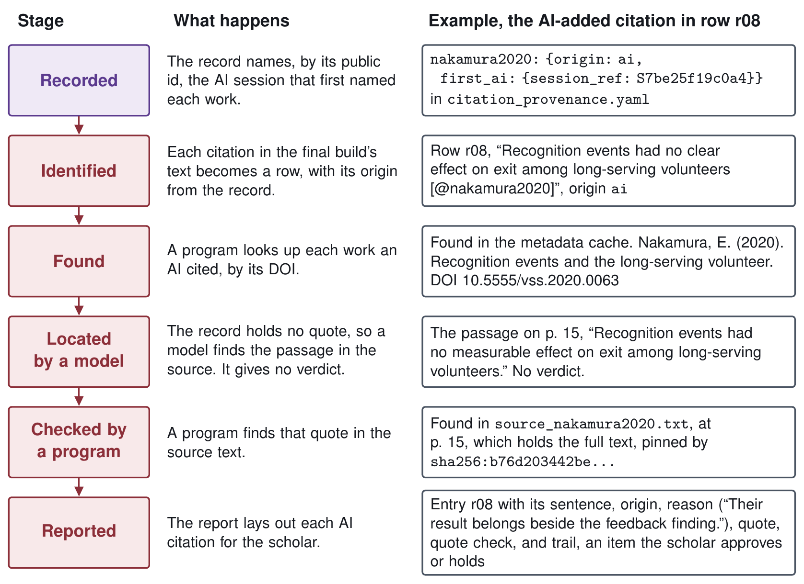
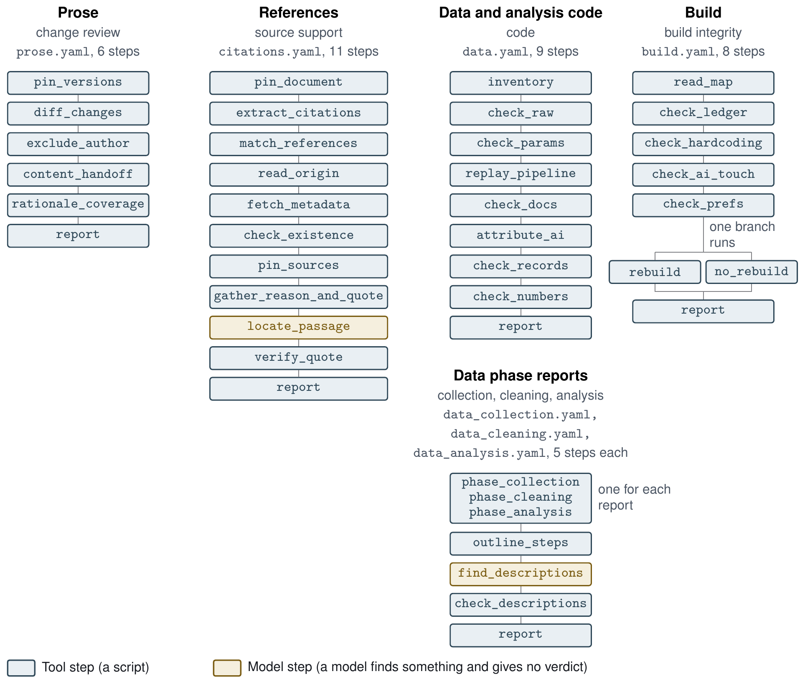

# Technical Appendix

*An AI-Enhanced Workflow for Verifiable Social Science*

## A1. Contents of this appendix and the research artifact

This appendix gives the status of each part of the workflow and offline commands that run the prototype. It explains how each part works, with the module contracts of the reproducible pipeline and the four verification procedures. It also covers the Stage 1 and Stage 2 development plan, the live judgment runs, privacy and security, and how AI was used to build the prototype and to draft this appendix.

The research artifact is one Git repository, verifiable-social-science-workflow at \[REPOSITORY URL\], at commit 742a422. With it a reader can build a research product from plain text, run the four verification procedures on the test files that come with them, and run the tests and commands in A4. A second repository, verifiable-proposal-demo at \[DEMO REPOSITORY URL\], holds the workflow run on the proposal and this appendix. It keeps both documents' source texts and numbered builds, the numbers this appendix cites with the scripts that compute them from an archive of the artifact, each verification report on both documents, made from the record of the AI sessions that wrote them, and a public index of those sessions, while the transcripts stay private.

## A2. The system

This section describes the workflow as designed, how its parts interact, and which parts the prototype has built.

Each layer's section ends with a table of the status of its parts, with the gaps and open questions that belong to that section and the Stage 2 item that covers each part, if any. Each part's status uses four words from the proposal's status section. "Built and tested" means code exists and a test exercises it. "Built" means code exists and no test exercises it. "Specified" means a design document describes it and no code exists, which is what the proposal calls designed but not yet built. "Planned" means it is named only as future work. The tables add four more. "Outside the artifact" marks software the research artifact does not include, "Open" marks a question the specification leaves undecided, "Not designed" marks a gap no document addresses yet, and "By hand" marks a step the scholar or an AI session does because no code does it yet.

### A2.1 How the parts connect

Figure A1 presents the proposed AI enhanced system using layers to represent the multi-layer architecture.

{alt="Figure A1. The workflow's layers and how an AI contribution moves through them, with the program of each verification procedure and of the reproducible pipeline. The data phase reports and the programs of the other layers are not shown." width="6.5in"}

The workflow is designed as a multi-level architecture presented as layers.

- **Scholar and External Software (A2.2).** Every scholar has preferred software, including an AI harness, an AI model, statistical software, a reference manager, a text editor, and a tech stack. The scholar's external software reaches the workflow through wrappers, Model Context Protocol (MCP) servers, and adapters.

- **Reproducible pipeline (A2.3).** A pipeline of documents and programs that build each research product from plain-text files.

- **Audit layer (A2.4).** The audit layer captures, records, stores, and tags every AI session transcript and tool call. In addition, the audit layer also contains the databases including the knowledge base where the procedural graphs are kept.

- **Verification layer (A2.5).** The verification layer is a series of programs and sequential steps that identify AI contributions in four streams, check them, and write reports for each stream. The scholar approves or holds each item, and the decisions go to the reproducible pipeline.

- **Observability layer (A2.6).** The observability layer lets the scholar watch AI work as it happens, including the work of subagents, AI programs outside the harness, and the knowledge base entries the AI reads.

### A2.2 Scholar: External Software

The proposal's Figure 2 draws the workflow as components, with the scholar, the AI model, and external software as inputs and the research product as output. The workflow does not replace the scholar's tools. It reaches the AI harness, the AI model, and the scholar's external software through three kinds of connectors: wrappers, MCP servers, and adapters.

Figure A2 shows the connections. Event adapters and wrappers turn what happens in the harness and in the scholar's software into events in a schema that fits the databases in the audit layer (A2.4). File adapters turn a tool's files into the fixed fields to be used in the verification layer (A2.5). MCP servers allow the harness and model to connect to tools, programs, and databases outside the system. The connectors sit outside any single project, so one setup serves every project a scholar runs.

{alt="Figure A2. How the workflow connects to the scholar's AI harness, AI model, and external software." width="6.5in"}

The workflow reaches the various external software programs through three kinds of connectors.

- **External Components:**

    - **AI harness.** The software that runs a model and connects it to tools and files, and so the scholar's point of contact with AI. Any harness can fill this slot. Triggers that start a verification procedure are designed for one harness's hooks, and AI work in another harness is caught at build time.

    - **AI model.** The model the harness runs and the judgment steps call. A provider setting, a base URL and a model name, makes the model swappable.

    - **External Software.** The scholar's own editor, statistical software, citation manager, version control, and build tools such as Pandoc, Make, or Quarto.

- **Connectors:**

    - **Wrappers.** Small programs that log each action in the scholar's external software for the audit layer.

    - **MCP servers.** Servers that expose the databases to the harness and the model through the Model Context Protocol, and MCP tools that bring events in from software outside the workflow.

    - **Adapters.** Small programs that translate a tool's files or actions into the forms the workflow reads, such as a Word document with tracked changes into the fields the prose procedure checks.

#### Status

Table A1. Status of the scholar's external software and the connectors

| Part | Status | Note |
|--------------------------------------------|-------------------|-------------------------------------|
| Provider setting | Built and tested | Shown and written with `python3 -m connections provider show` and `provider set` |
| Wrappers that log actions in external software | Built and tested | `python3 -m connections wrap` runs a program unchanged and logs the call and each file it wrote as events |
| MCP servers for the databases | Built and tested | Three servers inside the artifact, `workflow-kb` with {{num:kb.tools.word}} read-only tools, `workflow-audit` for the audit store's rows, and `workflow-events` with `record_event` |

### A2.3 The reproducible pipeline

The reproducible pipeline assembles research products through a build script [@healy2020]. It builds each research product from plain-text files. Figure A3 shows the pipeline. Two programs carry out the build, resolve fills in the computed results and build builds and numbers the research product. A separate command assembles the replication folder.

{width="6.5in"}

The pipeline does five things to keep a research product reproducible.

1.  **Computed results in the text.** A computed result enters the text through a placeholder such as [\{\{num:key\}\}]{custom-style="Verbatim Char"}, which the build fills from the manifest. Resolve fills the placeholders and stops any build with an unfilled one, listing every missing key. A manifest emitter writes the manifest from the analysis outputs.

2.  **Numbered builds.** Each build receives the next version number, a copy of its text with every placeholder filled, and a row in the ledger, a table that records each build's checksum. A checksum is a short code computed from a file's contents, which changes if even one character of the file changes. Before each new build, the build program recomputes the checksum of every earlier build and refuses to build while any of them differs from its ledger row or is missing.

3.  **Verification status.** The build reads the latest results file of each verification stream and runs no check itself (A2.5). A stream with out-of-date results, or with work the scholar has not approved, does not stop the build. Instead, the build flags the research product as unverified for that stream.

4.  **Project layout.** Each research product has one source file, and the project's build file names it, so it is always clear which draft is current. An older draft that could be mistaken for the current one is marked as archived.

5.  **Replication folder.** A separate command copies the source text, data, code, and build settings a research product needs into one folder, so that another researcher can rebuild the product from that folder alone.

Each pipeline program has a module contract, a short file that states what it takes in, what it returns, and which of its promises are frozen. Its code can change, but a frozen promise must not change without a change to the contract.

#### Status

Table A2. Status of the parts of the reproducible pipeline

| Part | Status | Note |
|--------------------------------------------|-------------------|-------------------------------------|
| The four pipeline modules and the command line | Built and tested | {{num:tests.pipeline_core}} tests |
| Slide builds (reveal.js) | Built and tested | {{num:tests.slides}} of the {{num:tests.pipeline_core}} tests above |
| Separating `ospipe` so that it holds only the pipeline's modules | Built and tested | `ospipe` holds only the pipeline's modules, and the five modules placed in other layers are built and tested, with {{num:tests.moved}} tests |
| Reading each stream's results file and marking a build unverified | Built and tested | The status is recorded in two ledger columns added in the build contract, `verification` and `runs` |
| Manifest emitter | Built and tested | `python3 -m ospipe emit-manifest` fills the numbers file from the analysis outputs |
| Project map and archive lines | Built and tested | The `products`, `add-product`, and `archive` commands, and the build procedure checks a map and archive lines in its test project |
| Notes templates (`templates/notes/`) | Built and tested | `python3 -m ospipe install-notes` copies the templates into a project's `notes/` and never overwrites a file |
| Replication folder with fixed-date builds (`make emit`) | Built and tested | `make emit PRODUCT=<name>` puts `ship/<product>/` in place only after a copy rebuilds with a match |
| Citation evidence file and the list of unverified claims | Built and tested | The `citation-evidence` and `unverified` commands, and the replication folder writes both files |

### A2.4 The audit layer

The audit layer records, stores, and tags every AI session transcript and tool call, and holds the system's databases. The proposal grounds the audit layer in a documented chain from each element of a research product to the inputs, sources, scripts, and sessions that produced it.

Figure A4 shows the layer. Capture sweeps each harness's session files and the wrappers' events (A2.2), keeps each transcript unchanged, and tags what it finds in two passes before writing it to the databases. The audit layer feeds the observability layer as records are written and the verification layer after the fact, the harness reaches the knowledge base through a knowledge base server, and a project's records are written out as files for the pipeline and its replication folder. Privacy and retention of these records are discussed in A6.

{width="6.5in"}

The rest of this section covers the databases and schema, the knowledge base, capture, and metadata tagging.

#### Databases and schema

Table A3 summarizes the schema. One database holds five stores, and a file store beside it keeps each file once, however many times it is used.

Table A3. The stores of the database and the tables they share

| Store | What it holds | Main fields |
|-------------|---------------------------|------------------------------------------------------------|
| Audit | Each AI session, the work done in it, and its full transcript | Sessions with their identity, times, and a derived title, gist, summary, and keywords, each stamped with the pass that produced it. Events with an ordinal, a verb, a kind (action, decision, observation, or blocker), an object, and a rationale. Transcripts kept whole in the file store |
| Knowledge | Standards, guidelines, and procedural graphs | An entry class, title, gist, keywords, content, and a checksum of the source material, and a history table that keeps every prior version |
| Sources | Each cited source and its retrieved original | Bibliographic metadata, an identifier block (DOI, OpenAlex, and Semantic Scholar), retrieval status, a content fingerprint, the retrieved original with its retrieval method and date, and extracted text by kind with its conversion method |
| Data | Collected data, held as data rather than as pointers to files | One typed table per dataset, written once, with a catalog row (name, version, row count, checksum, and collection date) and one codebook row per variable |
| Working | Snapshots of notes, scripts, and drafts | The workspace-relative path and kind of each snapshot |
| Shared tables | Projects, field definitions, and file forms | No links table, so no table keeps a citation's quote, location, or who settled it, and each row's `supersedes` column names the row it supersedes. A row for each project. Each field's definition, generation rule, and null behavior. An export registry giving each element type's file form and path |

Audit records and datasets are never overwritten, and a correction is added as a new record that supersedes the old one.

#### Knowledge base

The knowledge base holds standards as entry files and also holds the procedural graphs that encode methods and verification procedures. The harness and the model reach it through a knowledge base server, which searches an index of the entry files, and the knowledge store of Table A3 keeps each entry and its prior versions. The entries are created, managed, and served as follows:

- **Creating entries.** Each entry is one markdown file whose heading fixes its identifier, title, source, source version, date, and group, and whose body gives a short answer first, then the facts, then related entries.

- **Managing entries.** A history table keeps every prior version, and the checksum of an entry's source shows when the source has changed since the entry was written.

- **Serving entries.** A read-only knowledge base server offers {{num:kb.tools.word}} tools, an overview of the corpus, search, a list of entries, a full entry, and an entry's origin.

##### Procedural graphs

A procedural graph [@lu2026] is a record of how to carry out a task, kept in the system's knowledge base so that a person can read and edit it. Like any graph, it is made of nodes joined by edges. Each node is one step, such as a tool call or a reasoning step, and each edge is an arrow from one step to a step allowed to follow it, so one step can lead to more than one next step. Each edge carries three notes, a condition that says when to take it, guidance on how to proceed, and pitfalls to avoid. In the build procedure, for example, the step that checks each build against its ledger has two edges with conditions on the ledger. One leads to a rebuild of each ledgered build, with the condition that the ledger has at least one row, the guidance to compare the rebuild with the ledger's checksum rather than with the file on disk, and pitfalls such as calling a difference a direct edit when a different Pandoc version can change the bytes. The other skips the rebuild when the ledger is empty.

The procedural graph system adds to these graphs a program, the runtime, that carries out each step and checks its output against a contract for that step. Running the graph this way is our extension of @lu2026. Each graph also gets a knowledge base entry naming its purpose, triggers, steps, and the command that runs it, so that a session finds a procedure through the server's search like any other entry, while the runtime rather than the server runs it.

In the prototype, each graph is a file in a structured plain-text format (YAML) with two kinds of steps. Tool steps run Python scripts, all deterministic except the bibliographic lookup and the operational graphs' steps that run git or ssh commands, and judgment steps put fixed questions about each item to an AI model. A step contract lists the files that a step reads and the shape of each file it must produce, with field types and allowed values. Figure A5 shows how the runtime uses them.

{width="6.5in"}

The runtime executes the steps in a fixed order. It stops a run when a step breaks its contract.

Each run leaves a folder recording what ran, the versions of the graph and its inputs, the exact code of each tool step and the prompts, every model answer, and the report. A verify command reruns the tool steps and confirms they give the same results, except the bibliographic lookup and the operational graphs' git and ssh steps, whose outputs it only hashes. Model answers are kept for review rather than rerun, since a model can answer differently each time.

The runtime has {{num:runtime.commands.word}} commands, `check`, `run`, `step`, `verify`, `score`, `advise`, `decide`, which records the scholar's approve or hold, and `procedures`, which prints or checks the registry. A new procedure needs a procedural graph, a step contract and code or a prompt for each step, and clean and seeded test files with a truth file, while the runtime's `check` command validates the graph's structure.

Beyond verification, our procedural graph extension can be used to guide at least three other procedures. First, graphs for research methods, such as difference-in-differences, use the same representation but run, outside the research artifact, under a separate runtime with their own kinds of step. Second, graphs also hold reusable procedures for research tasks unique to a scholar's institution and preferences, such as connecting to a university high-performance computing cluster or adding a project to GitHub. Third, wrappers and MCP servers can also be written as procedural graphs.

#### Capture

The capture step automatically collects every AI session and tool call. It sweeps each harness's session files while a session runs, when it ends, and again on a schedule, through one event schema with an adapter for each harness.

#### Metadata tagging

The tagging step fills the fields with metadata in two passes, one mechanical and one using an AI model. Table A4 lists the fields each pass fills.

Table A4. The fields each tagging pass fills

| Pass | Field | Description |
|------------------------|--------------|--------------------------------------------------------------|
| Mechanical (a program, no model) | Session | Identifier, start, and end |
| | Project | The project the session belongs to |
| | Tools | The harness and tools the session used |
| | Files | Each file touched, with its role (produced, edited, read, or cited) |
| | Actions | Each action, with a verb from a fixed list (wrote, edited, ran, searched, verified, committed) and whether it was an action or an observation |
| Model (one AI model call per session) | Title | A short title for the session |
| | Gist | One line on what the session did |
| | Summary | A short paragraph |
| | Keywords | Terms for search |
| | Decisions | Each decision in the action log, with a one-sentence rationale |

Model-pass fields stay marked unreviewed until a person reviews them.

#### Status

Table A5. Status of the parts of the audit layer

| Part | Status | Note |
|--------------------------------------------|-------------------|-------------------------------------|
| Database file and file store, provenance on every row, and the two tests of written-out files | Built and tested | One SQLite file, `audit.sqlite`, with a file store beside it and the provenance fields (session, origin, method, reason) on every row |
| Stores for collected data, sources, and working files | Built and tested | |
| Shared tables (projects, field definitions, export registry) | Built and tested | There is no links table, so the store keeps no citation's quote, location, or who settled it |
| Choice of database software and how a scholar adds a table or field | Built and tested | One SQLite file, `audit.sqlite`, with its schema in code, so a new table or field means editing `TABLES` in `store.py` and `FIELDS` in `fields.py`. Only datasets get tables of their own, one per version through `python3 -m audit_layer data add` |
| Knowledge base entries as files (`kb`, {{num:kb.entries}} entries) | Built and tested | {{num:kb.outside.word_cap}} entries describe AI skills outside the artifact |
| Knowledge base server with {{num:kb.tools.word}} read-only tools, and its entry checker | Built and tested | The server is `workflow-kb` (`python3 -m connections serve kb`), and the checker is `python3 -m audit_layer.kb check` |
| Knowledge store | Built and tested | Two tables of `audit.sqlite`, `knowledge_entries` and `knowledge_history`, loaded from the entry files by a fixed field mapping, with no search |
| Cross-project loop, standards proven in one project registered for the next | Planned | A long-term goal in the specification |
| Procedural graphs kept in the knowledge base | Built and tested | An entry generated from each graph names its purpose, triggers, steps, and run command |
| Graph format, step contracts, and step code (`graphs/`, `contracts/`, `implementations/`) | Built and tested | |
| Runtime with {{num:runtime.commands.word}} commands, step records, and replay (`vg.py`) | Built and tested | Tests cover the `verify` command reporting a failed replay, the `score` command reporting a missed fault, the refusal to run a step after its graph file changed, and the `advise` command |
| Self-test graph (`graphs/selftest.yaml`) | Built and tested | |
| Methods graphs | Outside the artifact | Built |
| Operational-task graphs | Built and tested | `ops_github` adds a project to GitHub, `ops_hpc` connects a project to a university cluster, and `ops_publish` checks an assembled verification repository (A2.7) before it is made public |
| Wrappers and MCP servers written as procedural graphs | Built and tested | `wrap_git` turns the git wrapper's calls into events, and the `workflow-kb` server runs `mcp_kb` for each call |
| Authoring guide for new procedures | Built and tested | `verification_procedures/AUTHORING.md`, checked against `vg.py` by a test, with a knowledge base entry |
| Procedure for evaluating LLM runs | Built and tested | The `llm_runs` graph checks a finished run's saved prompts, answers, models, and replay without asking a model |
| Capture through one event schema with an adapter for each harness | Built and tested | Adapters for Claude Code, ForgeCode, and the wrappers' event files |
| Audit store of sessions, events, full transcripts, and metadata | Built and tested | Each transcript is kept whole in the file store |
| Records the procedures read (file writes, AI rationales, citation provenance, AI file edits) | Built and tested | Readers only, and every test record is synthetic |
| Checks for missed or interrupted captures | Built and tested | `python3 -m audit_layer check-captures` lists what the sweep has yet to do and changes nothing |
| Review before sharing a project's reports and session index | Built and tested | The verification repository feature (A2.7) withholds the scholar's name from the session index, and `ops_publish` scans every assembled file for names, emails, home and temporary paths, keys, raw session identifiers, and excluded folders before the repository is made public |
| Privacy controls for audit records and the databases (redaction, retention limits, access) | Not designed | See A6 |
| Recording which model and version answered each AI call | Not designed | Run manifests name the judge and second-checker models but not their versions. The audit store records each session's models and harness version from its transcript, and a live run saves each whole reply with the model the service reports |
| Mechanical tagging pass | Built and tested | For Claude Code and ForgeCode sessions, with the fixed list of verbs and the file roles, though no rule yet gives a file the role cited |
| Model tagging pass, unreviewed until a person reviews it | Built and tested | `python3 -m audit_layer tag`, with `python3 -m audit_layer review` listing and recording a person's review |

### A2.5 The verification layer

The verification layer checks AI contributions with one verification procedure for each of the four streams. Figure A6 follows one AI-added citation from the citation provenance record that names the AI session that first named it to its entry in the references report. Tool steps then check what a program can check, and judgment steps put fixed questions to an AI model. Each result is saved with the record of the step that produced it, and the report is written from those results. The scholar then approves or holds each item.

{alt="Figure A6. How one AI contribution goes from recorded to a verification report, followed for one AI-added citation in the seeded references test files. The record of sessions holds the citation, and the citation provenance record names the AI session that first named the work. The citation is identified in the final build's text, and its work is found in the metadata cache. A model locates the passage the sentence draws on and gives no verdict, and a program checks the quote against the source text. The report lists the citation as an item for the scholar to approve or hold." width="6.5in"}

#### The four verification procedures

Each procedure has tool steps, and only the references procedure also has a judgment step. Each of the three data phase reports below also has one judgment step. Figure A7 shows the steps of each procedure and each data phase report in the order the runtime runs them.

{alt="Figure A7. The steps of the four verification procedures and the three data phase reports, in the order the runtime runs them. Prose runs pin_versions, diff_changes, exclude_author, content_handoff, rationale_coverage, and report. References runs pin_document, extract_citations, match_references, read_origin, fetch_metadata, check_existence, pin_sources, gather_reason_and_quote, locate_passage, its one judgment step, verify_quote, and report. Data and analysis code runs inventory, check_raw, check_params, replay_pipeline, check_docs, attribute_ai, check_records, check_numbers, and report. The data collection, data cleaning, and data analysis reports each run a step naming the phase, outline_steps, find_descriptions, their one judgment step, check_descriptions, and report. Build runs read_map, check_ledger, check_hardcoding, check_ai_touch, check_prefs, rebuild or no_rebuild, and report. The lines show that order, not the graphs' transitions, and at each fork only one side runs." width="6.5in"}

Each procedure checks its stream as follows, with the three data phase reports beside the data procedure.

- **Prose.** Each AI edit has to come with a stated reason. A program lines up the changes between two drafts and flags each AI change with no recorded reason, and the scholar judges whether each reason fits its change. For Word, programs use Word's compare feature to show AI changes as tracked changes, then read back the scholar's responses.

- **References.** A program reads who first named each cited work from the citation provenance record, says whether each AI citation's work can be found (in the metadata cache, then Crossref, then DataCite) and checks each exact quote against the source text. For an AI citation whose record holds no quote found in its source text, a model locates the passage the sentence draws on and gives no verdict. No model judges whether the source supports the sentence.

- **Data and analysis code.** A program reruns the analysis from the raw data in an empty folder and checks that every value in the manifest of computed results (A2.3) matches the rerun. A program also marks the scripts and parameters an AI wrote or changed, from the record of the AI's file edits, with each recorded reason. No model is used.

- **Data phases.** Three reports, for data collection, data cleaning, and data analysis, each show one phase. Each lists the steps the phase's scripts mark, then each step with its exact code, then each sentence of the final build's text that describes the phase with where the scripts carry it out. A model finds the sentences and the places, and a program checks that each quote is in the text and each place is in the scripts. No model judges whether a description fits its code.

- **Build.** A program checks that each research product comes only from its build and matches its ledger and a rebuild from the copy of its text kept with the build. No model is used.

#### Verification reports

Each run that completes writes one verification report for its stream, problems first, then every item with its evidence. The references report instead ranks nothing and leads with a table of counts, then each citation, unless the draft's citations cannot be read. At this stage the reports of the four procedures and the three data phase reports are general purpose, and the intent is that they stay flexible as standards change.

One shared function writes the title, introduction, summary, problems table, and notes of every report, and leaves out the summary and problems table for a report that ranks nothing, such as the references report. Each stream's schema lays out that stream's own sections, which the same function writes, and a program for each stream only fills the schema's fields.

A model's answers enter a report as evidence for the scholar, not as findings, such as a located passage in a citation's Quote line or a found description with its places in a data phase report. A program checks each answer, and the findings are that program's. The decision to approve each item for the reproducible pipeline is the scholar's. The scholar can approve an item that has a finding, or hold one that has none. Each decision records who made it, when, and on which report run, and is kept in the stream's results file beside its rows, so it reaches the pipeline with the results (A2.3). The report shows which items are approved. An item the scholar holds or has not yet decided does not stop a build, and the research product carries the mark `unverified: <stream>` until every item in that stream is approved and the stream's results match the build's inputs.

**Example.** The references report from the seeded run in A4 follows, abridged, with omissions noted in brackets and a long checksum shortened. Its entry for row r08 is the citation followed in Figure A6.

::: {custom-style="Report Text"}

**References report**

The text read is the final build's text, `draft.md` (sha256:{{num:excerpt.doc_sha}}...). Each citation in it is listed with who first named the cited work in the record of sessions and artifacts. For each citation from an AI, the report says whether the work could be found, and for each work found it gives the AI's recorded reason and a quote, which a program then looks for in the source text. Nothing here is a verdict. The scholar approves or holds each citation from an AI and each one the record never names.

| Count | Number |
|----------------------------------------------------|-----------|
| Citations in the final build | {{num:excerpt.citations}} |
| From an AI | {{num:excerpt.ai}} |
| The scholar's | {{num:excerpt.scholar}} |
| Never named in the record | {{num:excerpt.unknown}} |
| Works not found | {{num:excerpt.not_found}} |
| Works not looked up | {{num:excerpt.not_looked_up}} |
| AI citations with no quote found in their source | {{num:excerpt.no_quote_found}} |
| Quotes in the record not found in their source | {{num:excerpt.record_quote_not_found}} |
| AI citations with no recorded reason | {{num:excerpt.no_reason}} |

**Citations**

**From an AI ({{num:excerpt.ai}})**

*\[{{num:excerpt.ai_before}} entries omitted\]*

**r08: \@nakamura2020**

• **Sentence:** Recognition events had no clear effect on exit among long-serving volunteers \[\@nakamura2020\].

• **Origin:** First named by an AI at 2026-10-13T10:03:20Z in session S7be25f19c0a4, where the record reads "Nakamura (2020) looked at recognition events among long-serving volunteers."

• **Session:** S7be25f19c0a4

• **Reference:** Nakamura, E. (2020). Recognition events and the long-serving volunteer. Voluntary Sector Studies. doi:10.5555/vss.2020.0063

• **Found:** found in the metadata cache (DOI 10.5555/vss.2020.0063). The record reads Nakamura, E. (2020). Recognition events and the long-serving volunteer. Voluntary Sector Studies. Type journal-article.

• **Reason:** "Nakamura (2020) looked at recognition events among long-serving volunteers. Their result belongs beside the feedback finding." (said by the AI at 2026-10-13T10:03:20Z in session S7be25f19c0a4)

• **Quote:** "Recognition events had no measurable effect on exit among long-serving volunteers." (located by recorded:recorded_judge.json, at {{num:excerpt.row_location}})

• **Quote check:** found in source_nakamura2020.txt, at {{num:excerpt.row_location}}, which holds the full text

• **Trail:** origin from citation_provenance.yaml (record 04_read_origin); lookup (records 05_fetch_metadata, 06_check_existence); source text source_nakamura2020.txt sha256:{{num:excerpt.row_source_sha}}... (record 07_pin_sources); passage located by recorded:recorded_judge.json (record 09_locate_passage); quote checked by a program (record 10_verify_quote); times are each record's started_at

*\[{{num:excerpt.ai_after}} entries omitted\]*

**Never named in the record ({{num:excerpt.unknown}})**

*\[{{num:excerpt.unknown}} entries omitted\]*

**The scholar's citations, not checked further ({{num:excerpt.scholar}})**

*\[{{num:excerpt.scholar}} entries omitted\]*

**Notes**

*\[{{num:excerpt.notes_omitted}} notes omitted\]*

:::

#### Status

Table A6. Status of the parts of the verification layer

| Part | Status | Note |
|--------------------------------------------|-------------------|-------------------------------------|
| The four verification procedures | Built and tested | {{num:tests.procedures}} of the {{num:tests.verification}} verification tests |
| The three data phase reports (collection, cleaning, and analysis) | Built and tested | {{num:tests.phases}} of the {{num:tests.verification}} verification tests |
| Clean and seeded test files, truth files, and scoring | Built and tested | |
| Second checker | Built and tested | No procedure has a second checker since the references procedure was rebuilt. The runtime keeps the second role and refuses a run whose judge and second checker are the same model |
| Live judgment | Built and tested | Tested against a stand-in model service. The October 8 runs (A5) used earlier procedures, and the demo repository (A1) holds live runs of the current references procedure on the proposal and this appendix |
| Live bibliographic lookup | Built and tested | Tested against stand-ins for Crossref and DataCite, and never run against either real service |
| A report for each stream, written through one shared report function | Built and tested | Each stream's own sections are laid out in its schema and written by the one report builder |
| Versioned schema for each stream, with `not_run` fields, and one report builder | Built and tested | A version is raised by hand in each stream's schema, and a test fails on a changed schema without a new version |
| Results file for each stream | Built and tested | Each completed run writes `results.json`, and a handoff copies it to the project |
| Procedure registry and triggers | Built and tested | `registry.yaml` with `vg.py procedures`, Claude Code edit and end-of-turn triggers, and a `make verify` trigger |
| Adapters for Word, a citation manager's export, R, and Quarto | Built and tested | The Word adapter, `python3 -m connections adapt word`, writes the files the prose procedure reads, with a record entry for each sentence the AI author's tracked changes touch |
| Acceptance tests for the four parts above | Built and tested | `tests/test_acceptance.py` covers the schemas and builder, the results file, and the registry, and the connections tests cover the triggers and adapters |
| Word review modules (`annotate`, `returns`, `reconcile`) | Built and tested | {{num:tests.word_review}} tests |
| Word compare script (`verification_procedures/review/word_compare.applescript`) | Built | |
| Carrying accepted edits into the source text | By hand | Done by the scholar or an AI session, since no code does this yet |
| Flagging numbers typed into prose (`lint`) | Built and tested | {{num:tests.lint}} tests |
| Standard records for each transition | Specified | Only the build ledger is code |
| The scholar's approval of each item, kept in the results file and shown in the report | Built and tested | `vg.py decide` with `--approve` or `--hold` and `--by` records each decision in the run's `results.json` and writes `report_decided.md` |
| Two levels of verification, light working checks and formal build checks | Built and tested | `vg.py run <id> --quick` runs the registry's quick steps as the light check, and the full run that writes the results file is the formal check |
| Seeded-fault test on a full synthetic manuscript | Planned | Placed after Stage 2 in the specification |

### A2.6 The observability layer

The observability layer enables the scholar to observe an AI model's reasoning where the model exposes it, the tool calls, and the tool results. The scholar can view these in the observability dashboard, the teal box in the proposal's Figure 2. The layer's events come from the audit layer's record and, through the wrappers and MCP tools of A2.2, from software outside the workflow. Some harnesses already show elements of these in the chat interface. The layer adds observability of the work of subagents, AI programs that run outside the harness, and the knowledge base entries the AI reads, in one view that is the same for every harness and can be reopened after the session ends.

The observability layer uses the audit layer's record as it is written, with events that follow OpenTelemetry's conventions for AI calls so that the view does not depend on any one harness (Figure A4). A harness that already exports these events in OpenTelemetry's form needs only a setting to send them to the record. The setting is turned on one project folder at a time, so sessions in folders the scholar excludes, such as those holding student records, are never recorded (A6).

#### Status

Table A7. Status of the parts of the observability layer

| Part | Status | Note |
|--------------------------------------------|-------------------|-------------------------------------|
| Reading the audit record live, with events in OpenTelemetry's conventions | Built and tested | `python3 -m observability watch` rebuilds the view when the record changes and writes each session or run as a trace file in OpenTelemetry's conventions. A harness's own OpenTelemetry export sent to the record is still open |
| Observability dashboard | Built and tested | A page that `python3 -m observability build` copies into the view beside the trace data, which opens from disk with no server |
| MCP tools that bring events from outside software into the live view | Built and tested | `python3 -m connections serve events` gives an MCP client one tool, `record_event`, and the wrappers of A2.2 carry the same events |

### A2.7 Features

The proposal names two features that lower the cost of adopting the workflow and an interactive web portal that helps scholars learn and use it over the long term. Scholars can add features of their own, such as custom skills and programs, and each enters as a program with a declared contract and leaves the same records as any AI session. The three the proposal names come first below, then a fourth built in Stage 1, then custom skills.

- **Pipeline setup.** An AI-assisted workflow that builds a reproducible pipeline for a project and connects it to the scholar's software and harness.

- **Project organizer.** A tool that uses AI to organize files, builds, and past sessions, with every change observable and reversible, under the rule that AI never deletes and marks instead.

- **Interactive web portal.** A site that helps scholars learn, implement, and critique the workflow, built on a catalog site generator.

- **Verification repository.** A feature that assembles a project's files, every verification report, and the session index into a repository laid out like the demo repository of A1, with each number it shows taken from the results files and ledgers, and a procedure that checks the assembled files for private material before they are made public.

- **Custom skills.** Skills and programs unique to each scholar such as agentic systems developed to help with manuscript editing, literature searches, and source retrieval.

#### Status

Table A8. Status of the features

| Part                   | Status  | Note                                        |
|--------------------------------------------|-------------------|-------------------------------------|
| Pipeline setup         | Built and tested | `python3 -m features setup system`, run once, and `python3 -m features setup project`, run for each project |
| Project organizer      | Built and tested | `python3 -m features organize` refuses any delete and asks that the item be marked unused instead |
| Interactive web portal | Built and tested | `python3 -m features portal build` writes a static site from the knowledge base entries, the graphs, and the layers' guides |
| Verification repository | Built and tested | `python3 -m features publish plan` shows what would be published and writes nothing, `publish build` writes the repository, and `ops_publish` (A2.4) checks it |

## A3. Development plan

Stage 1 built the prototype and the research artifact this appendix describes. Stage 2, from January to May 2027, completes the verification layer and tests it through the proposal's five items. Table A9 gives the plan by month with the special issue's dates and names what each Stage 2 item starts from in the research artifact, and the Stage 2 item column of each status table shows which item covers each part.

Table A9. Development calendar for Stages 1 and 2

| When | Stage | Development | Starts from (in the research artifact) |
|----------------|---------|-----------------------------------------|----------------------------------|
| July 2026 | 1 | Reproducible pipeline built and tested, with its module contracts and the knowledge base files | |
| August to September 2026 | 1 | Designs for the databases and the file protocol | |
| October 2026 | 1 | Verification runtime and four procedures built and tested, and live judgment runs (October 8). Verification procedures design (October 9) and system specification draft 0.10 (October 22) | |
| By November 1, 2026 | 1 | Research artifact released at commit 742a422, and the proposal, this appendix, and the artifact submitted | |
| November 2026 to January 10, 2027 | 1 | Selection by the special issue editors, with selected projects notified January 10 | |
| January 2027 | 2 | Item 1, "finalize the procedural graph system, so that verification procedures, wrappers, MCP servers, and operational tasks can all be written as procedural graphs" | The graph format, the runtime with its {{num:runtime.commands.word}} commands, step contracts, a self-test graph showing the runtime is not tied to the four streams, and graphs for operational tasks (`ops_github`, `ops_hpc`), a wrapper (`wrap_git`), an MCP server (`mcp_kb`), and the evaluation of LLM runs (`llm_runs`) |
| January to March 2027 | 2 | Item 2, "finish testing the verification layer" | Four procedures with their clean and seeded test files, three data phase reports sharing one clean and one seeded set, {{num:tests.verification}} tests, and the live runs of the earlier procedures (A5). Already built and tested are versioned schemas and one report builder, the results file and the scholar's approval of each item, the registry and harness triggers, adapters (A2.2, A2.5), and an `ospipe` that holds only the pipeline's modules (A2.3) |
| February 27 to 28, 2027 | 2 | Special issue workshop (date tentative) | |
| March to April 2027 | 2 | Item 3, "extend the observability layer and test the associated wrappers and MCP tools ..., with the same events written to the logs" | The observability layer, the wrappers, and the events MCP tool, and audit capture, storage, and tagging, all built and tested (A2.2, A2.4, A2.6), the step of the build procedure that already reads a session record of file writes, and the data and references procedures, which read the record of the AI's file edits and the citation provenance record (A2.4) |
| April to May 2027 | 2 | Item 4, "test the workflow across multiple open-source harnesses, models, external software integrations and scenarios" | Judges chosen per run, recorded answers, and the clean and seeded test files |
| May 2027 | 2 | Item 5, "develop an interactive web portal to help scholars learn, implement, and critique the workflow" | A web portal, built and tested, which `python3 -m features portal build` writes as a static site (A2.7) |

Item 1 is described in the system specification's definition of the procedural graph system and in the verification procedures design's authoring guide and procedure registry, neither of which yet describes wrappers or MCP servers as procedural graphs. Item 2 is described in sections 1 to 6 of that design, apart from the scholar's approval of each item, and its acceptance tests include three harness triggers and the Make trigger. Item 3 rests on the system specification's description of the three layers and wrappers, item 4 on its provider setting for the AI model, and item 5 is named only in its Stage 2 list. The instruments that measure the verification work already run. They are the truth files of the seeded test files, the `score` and `verify` commands (A4, A5), and the {{num:tests.verification}} tests of the verification procedures, which report the planted faults caught, findings on clean files, and whether tool steps replay.

## A4. Running the prototype offline

The commands below build a sample project's research products, check its numbers, and run the procedures on their test files, answering judgment steps from recorded answers (A2.5). The research artifact is available \[ACCESS ROUTE\] under the MIT License for its code and procedure definitions and the Creative Commons Attribution 4.0 International License for its documentation, knowledge base corpus, and test materials. The commands need Python 3.9 or later with PyYAML, python-docx 1.2 or later, and `pytest`, plus Pandoc and Make on the command path. The build procedure's stored test builds were made with Pandoc 3.9.0.2. Under Pandoc 3.6.4, the one other version tried, earlier code failed one of its verification tests, and the build runs gave extra warnings, one replacing the blocking finding on the planted edit to a build. That trial was not repeated on the current code. The reported results come from macOS with Python 3.9.5, PyYAML 6.0.3, python-docx 1.2.0, `pytest` 8.4.2, and Pandoc 3.9.0.2. Linux and Windows were not tried. On earlier code, before the references, prose, and data procedures were rebuilt, the seeded and clean runs of the four procedures also gave the same results under Python 3.12.13, and this was not repeated on the current code.

Running the commands below needs a terminal with Python, and apart from fetching the repository and installing packages, none of them uses the network or calls an AI model. The repository's files total about {{num:repo.mb}} megabytes, and nothing in it needs a GPU. The first block fetches the prototype, installs its packages, and runs the {{num:tests.suites.word}} test suites.

```
git clone [REPOSITORY URL]
cd verifiable-social-science-workflow
git checkout 742a422
python3 -m venv ../vg-venv
. ../vg-venv/bin/activate
python3 -m pip install -r requirements.txt
(cd ospipe && python3 -m pytest -q)
(cd verification_procedures && python3 -m pytest -q)
python3 -m pytest -q audit_layer
python3 -m pytest -q examples/test_story
python3 -m pytest -q handoffs/tests
python3 -m pytest -q observability/tests
python3 -m pytest -q connections/tests
python3 -m pytest -q features/tests
```

The first suite reports `{{num:tests.ospipe}} passed` in about a minute and the second `{{num:tests.verification}} passed` in about 10 minutes. The other six report `{{num:tests.audit}} passed`, `{{num:tests.story}} passed`, `{{num:tests.handoffs}} passed`, `{{num:tests.observability}} passed`, `{{num:tests.connections}} passed`, and `{{num:tests.features}} passed`, in the order run, {{num:tests.total}} tests in all, and the whole block takes about 25 minutes.

The second block builds the two research products of a small sample project in `examples/sample_project/`, a one-page test manuscript and a {{num:sample.slides.word}}-slide deck abbreviated from a talk on prompting. Its analysis script computes the results the two products cite from one data file, the build fills them in from the project's numbers file, and the data procedure then checks each value in that file against a rerun of the analysis, on the project's files that a handoff gathers. A second handoff gathers the pipeline, its script, and the text of the latest manuscript build for the data analysis report, whose one model step is answered from recorded answers.

```
cd examples/sample_project
python3 s1_results.py
PYTHONPATH=../../ospipe python3 -m ospipe build --manuscript manuscript.md --manifest numbers.yml --tables-dir . --bib refs.bib --builds-dir builds/manuscript --purpose "sample manuscript"
PYTHONPATH=../../ospipe python3 -m ospipe build --manuscript slides.md --manifest numbers.yml --tables-dir . --to revealjs --builds-dir builds/slides --purpose "sample slides"
cd ../../verification_procedures
python3 ../handoffs/project_to_data.py --project ../examples/sample_project --to runs/demo_sample_inputs
python3 vg.py run graphs/data.yaml --run runs/demo_sample --inputs runs/demo_sample_inputs
python3 ../handoffs/project_to_data_phases.py --project ../examples/sample_project --to runs/demo_sample_phases
python3 vg.py run graphs/data_analysis.yaml --run runs/demo_sample_analysis --inputs runs/demo_sample_phases --judge recorded:../examples/sample_project/recorded_phases.json
```

Each build takes under a second and writes version `{{num:sample.version}}`, the manuscript as `builds/manuscript/{{num:sample.manuscript_version}}.docx` and the slides as `builds/slides/{{num:sample.slides_version}}.html`, each with a copy of its filled-in text and a row in its ledger. A placeholder with no value stops the build, which lists every missing key. Opening the slides in a browser loads the reveal.js library from the web. The data procedure's run takes under 3 seconds and reports {{num:sample.blocking}} blocking findings and {{num:sample.warnings}} warnings, with all {{num:sample.numbers}} cited numbers matching the rerun. In a trial with one number changed by hand in the numbers file, the run reported it as blocking. The data analysis report's outline lists {{num:sample.analysis_steps}} steps of the script, and a program confirms each description the model step found, {{num:sample.analysis_descriptions}} in all, in the text and the script.

The third block runs the references procedure (`citations`) on its seeded test files from `verification_procedures/`, then replays and scores the run.

```
VG_OFFLINE=1 python3 vg.py run graphs/citations.yaml --run runs/demo_citations --inputs fixtures/citations/seeded --judge recorded:fixtures/citations/seeded/recorded_judge.json
python3 vg.py verify --run runs/demo_citations
python3 vg.py score --run runs/demo_citations --truth fixtures/citations/seeded/truth.yaml
```

The run takes about 3 seconds and completes {{num:citations.steps_run}} of the graph's {{num:citations.steps}} steps, including its one judgment step, which locates passages and gives no verdict. The `verify` command reports `replay matches` for each of the {{num:citations.replays}} tool steps it reruns (A2.4), and the `score` command prints `{"faults": {{num:citations.faults}}, "recall": {{num:citations.recall}}, "missed": []} extras={{num:citations.extras}}`. Every finding in this report is a note, and only blocking findings and warnings count as extras. A2.5 shows part of the run's verification report.

The fourth block runs the prose and data procedures, the three data phase reports, and the build procedure on their seeded test files and scores the runs. The three data phase reports read one set of seeded test files with recorded answers, whose planted faults are all for the cleaning report, so only the cleaning run is scored. The prose, data, and build procedures have no judgment step.

```
python3 vg.py run graphs/prose.yaml --run runs/demo_prose --inputs fixtures/prose/seeded
python3 vg.py score --run runs/demo_prose --truth fixtures/prose/seeded/truth.yaml
python3 vg.py run graphs/data.yaml --run runs/demo_data --inputs fixtures/data/seeded
python3 vg.py score --run runs/demo_data --truth fixtures/data/seeded/truth.yaml
python3 vg.py run graphs/data_collection.yaml --run runs/demo_data_collection --inputs fixtures/data_phases/seeded --judge recorded:fixtures/data_phases/seeded/recorded_judge.json
python3 vg.py run graphs/data_cleaning.yaml --run runs/demo_data_cleaning --inputs fixtures/data_phases/seeded --judge recorded:fixtures/data_phases/seeded/recorded_judge.json
python3 vg.py run graphs/data_analysis.yaml --run runs/demo_data_analysis --inputs fixtures/data_phases/seeded --judge recorded:fixtures/data_phases/seeded/recorded_judge.json
python3 vg.py score --run runs/demo_data_cleaning --truth fixtures/data_phases/seeded/truth.yaml
python3 vg.py run graphs/build.yaml --run runs/demo_build --inputs fixtures/build/seeded
python3 vg.py score --run runs/demo_build --truth fixtures/build/seeded/truth.yaml
```

The `score` command reports every planted fault caught, {{num:prose.caught}} of {{num:prose.faults}} for prose, {{num:data.caught}} of {{num:data.faults}} for data, {{num:cleaning.caught}} of {{num:cleaning.faults}} for the data cleaning report, and {{num:build.caught}} of {{num:build.faults}} for build, with {{num:prose.extras}}, {{num:data.extras}}, {{num:cleaning.extras}}, and {{num:build.extras}} extra findings. The {{num:data.extras.word}} for data fall on items that planted faults touch. Each run takes under 3 seconds.

Offline runs take under 4 seconds per procedure on test sets of {{num:fixtures.min_files}} to {{num:fixtures.max_files}} files. A live run sends a model one request for each judged item, and the seeded references files have {{num:citations.judged}} judged items, each a passage to locate. The data procedure asks no model, and each data phase report sends one request holding the final build's text and the pipeline's scripts. Nothing has been measured on a full manuscript. Using the prototype today requires the command line, including pipeline setup (`python3 -m features setup system` and `python3 -m features setup project`) and the web portal (`python3 -m features portal build`).

## A5. Live judgment and its variation

The tests use recorded answers so that they give the same result on every run, while a live run saves every prompt and answer per item with a checksum of the prompt. A reader can therefore review the answers a run used even if a model answers differently on another run.

On October 8, 2026, {{num:live.runs.word}} development runs had AI models answer every judgment step in earlier versions of the references, data, and prose procedures, on the clean and seeded test files of that time. Those steps judged whether a source supports its sentence, with a second model's recheck and a proposed fix, whether each method's documentation describes its code, and whether each AI rationale describes its change. Of the steps these runs answered, the current procedures keep only the one that locates a passage. Table A10 gives the models and settings, and Table A11 the results. Both models are open-weight models reached through a university-hosted inference service, whose address the runtime reads from the provider setting (A2.2). Recorded answers let any reader run the references procedure and the three data phase reports without a model key (A4), and the other procedures ask no model, while rerunning live judgment needs a key to that service. The demo repository (A1) also holds live runs of the current references procedure on the proposal and this appendix, with `qwen/qwen3.8-27b` locating passages.

Table A10. Models and settings in the live runs (settings and parsing as coded in the committed runtime, because the October 8 runtime file was not saved)

| Item | Live runs of October 8, 2026 | Where to check |
|----------------|------------------------------------------------------|------------------------------|
| Judge model | `qwen/qwen3.5-122b`, for every judgment step except the references recheck | Run manifests and answer records |
| Second checker | `openai/gpt-oss-120b`, for the references recheck only | Same |
| Access | A university-hosted inference service through its chat completions interface, one message per item, with no state kept between items | `vg.py`, `provider_setting` (lines 571 to 609) and `call_executor` (lines 628 to 668) |
| Settings | Temperature 0 and a limit of 4,000 output tokens, with up to four attempts per request | `vg.py`, line 93 and lines 653 to 666 |
| Prompts | Rendered from templates then in `verification_procedures/implementations/<stream>/`, since removed or rewritten, filled with the procedure's goal, the guidance and pitfalls on the step's transitions, and the item, and saved per item, so the prompts now survive only in each run folder's `prompts/` | `vg.py`, lines 482 to 491, 679 to 685, and 966 to 968, and each run folder's `prompts/` |
| Parsing | Reasoning blocks stripped and a structured answer extracted, with one retry that adds a fixed note to the prompt when an answer does not parse, after which an unanswered item becomes a "not judged" warning | `vg.py`, lines 553 to 562, 671 to 672, 970 to 971, and 995 to 998 |
| What was saved | {{num:live.responses}} responses ({{num:live.items}} items and {{num:live.retries.word}} retry), answer text only, without reasoning output, token counts, finish reason, or seed | Run folders and `vg.py`, line 980 |

In the live runs, every planted fault was caught in all three procedures, and the {{num:live.judgment_faults.word}} that depend on judgment were caught by the models' own verdicts, read from the saved answers rather than from the score. The `score` command then counted a fault as caught when any blocking finding or warning named the same check and item, so a "not judged" warning also counted. It now counts a finding of any severity that names the fault's check and an item holding the fault's item. In a trial run with no model answers, the earlier prose procedure still scored {{num:prose_nojudge.caught}} of {{num:prose_nojudge.faults}}, and the current one has no model step. The clean files gave no warning or blocking finding for references and data, and {{num:live.prose.clean.findings.word}} warning for prose (Table A11).

In the live seeded references run, four of the {{num:live.citations.seeded.extras.word}} extra findings follow from planted faults. The fifth is a partly verdict on row r06, a sentence with no planted support fault whose recorded answer at the time was supports, and the second model agreed with the partly verdict. Row r06's reference then carried a planted wrong year, which was caught separately.

Table A11. Results of the live runs

| Run (procedure, test file) | Planted faults caught | Other warning or blocking findings | What the saved answers show |
|----------------------|--------------------|--------------------------|--------------------------------|
| References, seeded | {{num:live.citations.seeded.caught}} of {{num:live.citations.seeded.faults}}, including both that need judgment | {{num:live.citations.seeded.extras}}, described in the text | Verdicts differ from the recorded answers of that time on {{num:live.verdicts_differ}} of {{num:live.verdict_rows}} rows. The second model agreed with the first on all {{num:live.rechecks}} rechecks. |
| References, clean | None planted | None | None |
| Data, seeded | {{num:live.data.seeded.caught}} of {{num:live.data.seeded.faults}}, including the {{num:live.data.seeded.judgment_faults.word}} that needs judgment | {{num:live.data.seeded.extras}}, each on an item a planted fault touches | {{num:live.retries.word_cap}} long answer was cut off, and the retry answered |
| Data, clean | None planted | None | None |
| Prose, seeded, graph version {{num:live.prose_v01.seeded.graph_version}} | {{num:live.prose_v01.seeded.caught}} of {{num:live.prose_v01.seeded.faults}} | {{num:live.prose_v01.seeded.extras}}, a moved sentence whose rationale was judged dishonest and a disclosed change to a count judged to alter meaning beyond its rationale | Two pitfalls were added in version 0.2 from these errors |
| Prose, seeded, graph version {{num:live.prose_v02.seeded.graph_version}} | {{num:live.prose_v02.seeded.caught}} of {{num:live.prose_v02.seeded.faults}}, including all {{num:live.prose_v02.seeded.judgment_caught}} that need judgment | None | None |
| Prose, clean, graph version {{num:live.prose.clean.graph_version}} | None planted | {{num:live.prose.clean.findings}} warning, on a disclosed deletion | The model judged that the deletion changed meaning beyond its stated rationale |

Of note, the prose procedure's pitfalls and prompt wording were revised after its first live run, which made {{num:live.prose_v01.seeded.extras.word}} errors, and the same seeded test file was then run again. The clean prose warning came after that revision.

For all {{num:live.runs.word}} live runs, the saved code of most tool steps differs from the committed code, since the references, data, and prose procedures were rebuilt after October 8. No saved prompt can be rendered from the committed templates, which were removed or rewritten. All {{num:live.runs.word}} runs used contract files that differ from the committed ones, and each also used an earlier graph than the committed one. The runtime file is not recorded in run folders and changed on October 8. Every run folder from October 8 passed the `verify` command (A2.4) on October 23, 2026.

Each test file was run once per model configuration, except the seeded prose file, which was run again after the revision, so run-to-run variation has not been measured. Within these runs, live support verdicts differed from the recorded answers of that time on {{num:live.verdicts_differ}} of {{num:live.verdict_rows}} references rows, and {{num:live.retries.word}} data answer was cut off and parsed only on retry, with its finish reason not saved. The second model agreed with the first on all {{num:live.rechecks.word}} rechecks, and the recorded second answers of that time also agreed, so a disagreement between the two checkers did not occur in either mode before the second check was removed. The run records are in the research artifact's `verification_procedures/live_runs_2026-10-08/`.

## A6. Privacy and security

The test files are synthetic, written by hand or generated by scripts in the repository, and no file holds data about real people. The live runs reported in A5 sent only synthetic test content to the inference service they used, while on a real project the references procedure would send, for each AI citation whose record holds no quote found in its source text, the sentence, the reference, the AI's recorded reason, and the source text, and each data phase report would send the final build's text and the pipeline's scripts, but no data files. The prose, data, and build procedures send nothing to a model. The runtime reads the service's key from the environment, and no key or credential is stored in the repository. The runtime works only on copies of its inputs, apart from the operational graphs. When its settings set `apply` to true, `ops_github` writes a `.gitignore` and runs git in the real project folder, and `ops_hpc` runs ssh commands on the cluster. The data procedure runs a project's own Python scripts in a temporary folder, so running it on another project runs that project's code. As specified, the audit layer keeps full session transcripts and tool calls, locally and under the scholar's control, without expiry, so whatever a session reads enters the record. Capture skips sessions run in any folder the scholar excludes, though a session elsewhere that reads an excluded file still records it, and the specification has no redaction, retention-limit, or access rule yet. A project's reports and session index are shared through the verification repository feature (A2.7), whose check scans the assembled files for names, emails, paths, keys, and raw session identifiers before they are made public, and the transcripts themselves stay out of it. Sharing the session records with journals still needs a review step that is not yet designed. The same rules have to cover collected data in the databases, which MCP servers expose to the harness and the model, and the transcripts that the model pass of tagging sends to a model.

## A7. Use of AI in building the prototype

AI tools were used to help draft and edit the proposal and technical appendix and to build the research artifact. The AI tools include author-developed agentic workflows for search, retrieval, storage, and summarization of scientific manuscripts, Anthropic's Claude Code harness, and ForgeCode's open-source harness. AI models used include both proprietary (GPT 6, Opus 4.6, 4.8, 5.5, and Fable 5) and university-hosted open-weight models (gpt-oss-120b and Qwen 3.5, 3.6, and 3.8). The prototype's behavior is checked by its {{num:tests.suites.word}} test suites and by scoring each procedure's findings against the planted faults listed in its truth files (A2.5). This appendix was drafted with AI assistance from evidence reports on the repository and the saved run records. Every number in it was checked against the code at commit 742a422 or against those records, and every command was rerun on November 1, 2026.

## References
